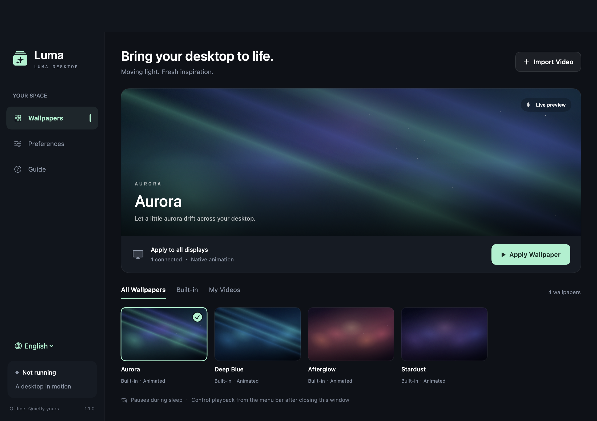

# Luma Desktop

[简体中文](README.md) | **English**

Bring your desktop to life.



Luma Desktop is a native macOS live wallpaper app built with Swift, SwiftUI, AppKit, and AVFoundation. It offers animated backgrounds, local video wallpapers, and menu bar controls. The app runs offline without a web container.

The interface supports Simplified Chinese and English. It follows your system language by default, and you can switch languages in the sidebar or Preferences.

### Download and use

1. Download the [app archive for Apple Silicon Macs](downloads/LumaDesktop-macOS-AppleSilicon.zip). On the file page, use the download button to save the archive.
2. Extract it and open `流光桌面.app`. You can also move the app to your Applications folder.
3. Choose a built-in wallpaper, or click **Import Video** to select a local video.
4. Click **Apply Wallpaper**.

On first launch, the app only displays a preview; your desktop changes when you apply a wallpaper. Closing the main window keeps the wallpaper running. Use the menu bar icon to pause, resume, stop, reopen the library, or quit. Stopping or quitting reveals your original system wallpaper.

**Requirements:** The supplied archive is for Apple Silicon Macs running macOS 13 or later. It has been tested on macOS 27.0.1. The app bundle is locally ad-hoc signed; it has no Developer ID signature or Apple notarization. You can also build it from source as described below.

### Features

- **Chinese and English UI:** Follow the system or choose a language manually. Changes apply immediately and persist without restarting.
- **Four animated backgrounds:** Aurora, Deep Blue, Afterglow, and Stardust, rendered with Core Animation and scaled to fit the display.
- **Local video wallpapers:** Import videos, generate thumbnails, and loop playback with audio muted. H.264 / HEVC videos in MP4 or MOV containers are recommended.
- **Independent preview:** Selecting a card previews the wallpaper; the desktop changes only after you apply it.
- **Multiple displays:** Apply to all displays or the primary display, with automatic updates when displays are connected or disconnected.
- **Appearance controls:** Fill or fit video scaling and wallpaper brightness adjustment.
- **Playback and power saving:** Manual pause; automatic pause during display or system sleep and inactive login sessions; optional pause on battery power or in Low Power Mode.
- **Startup and restoration:** Optional launch at login, a persistent library and settings, and restoration of the last applied wallpaper and manual pause state.
- **Normal desktop interaction:** Wallpapers sit below desktop icons, ignore mouse input, and leave the original system wallpaper files intact.

### Change the interface language

Click the globe icon at the bottom of the sidebar, or open **Preferences → Language**, then choose **System default**, **简体中文**, or **English**. The library, preferences, guide, application menus, and menu bar controls update immediately while preserving the wallpaper and playback state.

**System default** selects the first supported Chinese or English entry in your system language preferences, falling back to English when neither is available. Existing libraries are preserved and initially use System default.

### Build from source

You need macOS, Apple Command Line Tools with the Swift compiler, and Python 3. No third-party Swift packages are required.

```sh
git clone https://github.com/nmj94/luma-desktop.git
cd luma-desktop
./scripts/build.sh
```

The output is `dist/流光桌面.app`. The build script compiles for the architecture of the current Mac, generates the app icon, and applies a local signature. The source has not been tested on a physical Intel Mac.

### Run checks

Build the app and install `ffmpeg`, then run:

```sh
./scripts/test.sh
```

The checks cover language switching, saved language preferences, migration of existing settings, state and persistence, actual desktop windows, video import, thumbnail generation, looping, pause and resume, and removal of imported copies. The script generates a short video and uses an isolated temporary library. It briefly creates desktop windows, cleans them up, and exits without modifying the normal wallpaper library.

**26 model checks and 32 integration checks** passed in the environment described above. Reports and UI screenshots are saved to `build/test-artifacts/`. These results do not establish coverage of multiple physical displays, every macOS version, or an actual reboot and login sequence.

### Files and privacy

The app itself does not connect to the internet or require Screen Recording or Accessibility permissions. Imported videos are copied to:

```text
~/Library/Application Support/LumaDesktop/Media/
```

Settings are stored in `library.json` alongside the `Media` folder. Right-clicking a video card lets you remove the app's copy and thumbnail while keeping the original video intact. You can open the media folder from Preferences.

The repository includes source code, documentation, an app screenshot, and a downloadable app archive. Temporary build caches, test media, and user-imported videos are excluded from version control.

### Known limitations

- Wallpapers run on the logged-in desktop; they do not replace the lock screen or screen saver.
- Each display uses a separate player, so frame-perfect synchronization is not guaranteed. High-resolution or multi-display playback uses more resources.
- Battery power status is refreshed approximately every 15 seconds. Sleep and Low Power Mode changes are handled through system notifications.
- The smoothness of a video loop depends on its first and last frames.
- Keep the app in a stable location after enabling launch at login.
- The downloadable build has no Developer ID signature or Apple notarization.

### Project structure

| Path | Purpose |
| --- | --- |
| `Sources/Localization.swift` | Chinese and English text, language selection, and app errors |
| `Sources/MainView.swift` | Library, preview, and settings UI |
| `Sources/AppModel.swift` | Import, persistence, power policies, and launch at login |
| `Sources/WallpaperEngine.swift` | Desktop windows and video playback |
| `Sources/SceneView.swift` | Native animated scenes |
| `Sources/Models.swift` | Data models, backward-compatible storage, and pause policies |
| `Sources/main.swift` | App lifecycle and menu bar |
| `Resources/*.lproj/` | App names displayed by macOS |
| `Tests/` | Model and localization checks |
| `Sources/IntegrationChecks.swift` | In-app integration checks |
| `scripts/` | Build, icon generation, and validation |
| `docs/images/` | Chinese and English UI screenshots |
| `downloads/` | App archive for Apple Silicon Macs |

### References

- [Apple: CGWindowLevelKey](https://developer.apple.com/documentation/coregraphics/cgwindowlevelkey)
- [Apple: AVPlayerLooper](https://developer.apple.com/documentation/avfoundation/avplayerlooper)

---

[简体中文说明 →](README.md)
