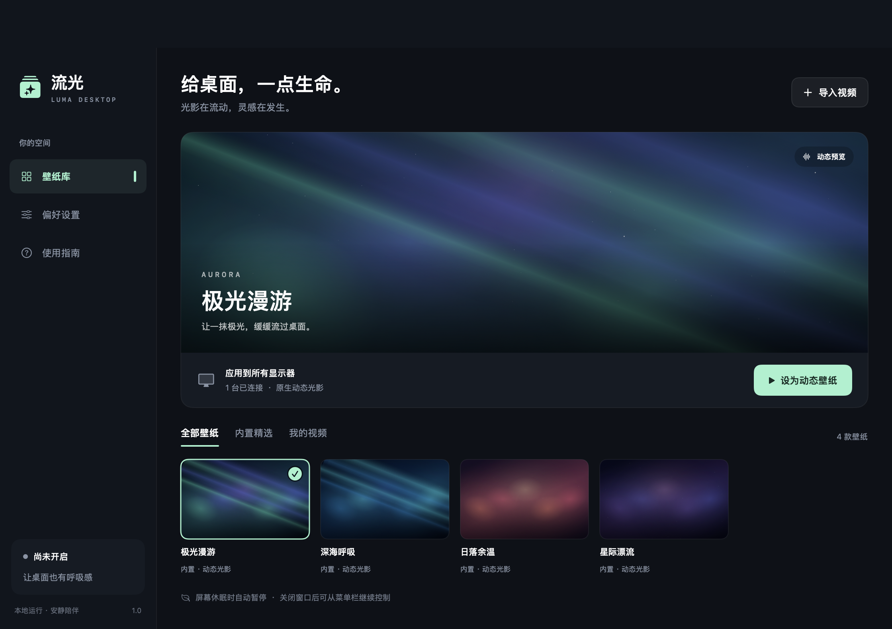

# 流光桌面 · Luma Desktop

一个 macOS 原生动态壁纸应用，使用 Swift、SwiftUI、AppKit 和 AVFoundation 编写。支持内置动态光影、本地视频壁纸和菜单栏控制，没有网页容器，没有网络依赖。



## 直接使用

1. 下载 [Apple 芯片 Mac 应用压缩包](downloads/LumaDesktop-macOS-AppleSilicon.zip)，解压后双击「流光桌面.app」。在 GitHub 文件页面点击下载按钮可保存压缩包。
2. 选择「极光漫游」「深海呼吸」「日落余温」「星际漂流」中的一款，或点击「导入视频」。
3. 点击「设为动态壁纸」。

关闭主窗口后，动态壁纸继续播放。点击屏幕顶部的流光菜单栏图标，可以暂停、继续、停止或退出。停止或退出会立即显示原来的系统桌面。

应用首次启动只显示预览，点击应用按钮后才改变桌面。你也可以把应用移到 Mac 的「应用程序」文件夹；开启「登录 Mac 时启动」后建议保持应用位置不变。

## 功能

- 四款由系统合成的动态光影，按屏幕尺寸自动适配。
- 导入本地视频、生成缩略图、静音循环播放。推荐 H.264 / HEVC 编码的 MP4、MOV。
- 独立的壁纸预览；选择一张卡片不会立即替换正在使用的桌面。
- 支持全部显示器或主显示器；插拔显示器后重新适配。
- 视频填满 / 完整显示、壁纸亮度调节。
- 手动暂停、屏幕和系统休眠暂停、非活动登录会话暂停。
- 可选电池供电暂停、低电量模式暂停、登录启动。
- 自动保存壁纸库、设置、最近应用的壁纸及手动暂停状态。
- 不修改系统原壁纸文件，不要求辅助功能或屏幕录制权限。

## 文件与隐私

应用不联网。导入的视频会复制到：

`~/Library/Application Support/LumaDesktop/Media/`

配置保存在同级 `library.json`。在视频卡片上点击右键可从库中移除；这只删除应用保存的副本和缩略图，不删除原始视频。偏好设置中可以打开媒体文件夹。

## 适用范围

- 提供的应用压缩包适用于 Apple 芯片 Mac，最低系统版本为 macOS 13；已在 macOS 27.0.1 上验证。
- 动态壁纸用于登录后的桌面；锁定屏幕、屏幕保护程序仍由系统管理。
- 多显示器分别使用播放器，视频不保证逐帧同步；较高分辨率或多个显示器会增加资源占用。
- 电池供电状态最长约 15 秒更新一次；系统休眠与低电量模式由系统通知触发。
- 本地视频的循环是否自然取决于素材的首尾画面。
- 本机使用的应用采用本地签名；面向其他用户公开分发前需要开发者签名和公证。

## 从源码构建

需要 macOS、Apple Command Line Tools（包含 Swift 编译器）和 Python 3。在项目目录运行：

```sh
./scripts/build.sh
```

输出为 `dist/流光桌面.app`。脚本会按照当前 Mac 的处理器架构编译原生程序、生成应用图标并进行本地签名，不需要第三方 Swift 包。源码尚未在 Intel Mac 上实机验证。

## 验证

先完成构建，并安装 `ffmpeg`，再运行：

```sh
./scripts/test.sh
```

验证脚本使用本机 `ffmpeg` 生成一个短视频，运行状态与持久化检查，以及实际桌面窗口 / 视频导入 / 循环 / 暂停恢复 / 删除副本的集成检查。集成检查使用独立临时壁纸库，会短暂创建桌面窗口，然后清理并退出，不修改正式壁纸库。

测试报告和界面截图保存在 `build/test-artifacts/`。已通过 15 项模型检查和 25 项集成检查。测试通过并不代表已经在多台实体显示器、所有 macOS 版本或实际关机登录流程上验证。

仓库包含源码、说明、应用截图和一个可下载的应用压缩包；临时编译缓存、测试媒体与用户导入的视频不纳入版本管理。

## 结构与依据

- `Sources/MainView.swift`：中文壁纸库、预览、偏好设置和使用指南。
- `Sources/AppModel.swift`：导入、持久化、节能策略和登录启动。
- `Sources/WallpaperEngine.swift`：位于桌面图标下方的窗口与独立视频播放器。
- `Sources/SceneView.swift`：由 Core Animation 绘制的动态场景。
- `Sources/Models.swift`：数据模型、存储与暂停策略。
- `Sources/main.swift`：应用生命周期、菜单栏和主窗口。

桌面层级使用 Apple 的 [CGWindowLevelKey](https://developer.apple.com/documentation/coregraphics/cgwindowlevelkey)；视频循环使用 [AVPlayerLooper](https://developer.apple.com/documentation/avfoundation/avplayerlooper)。
